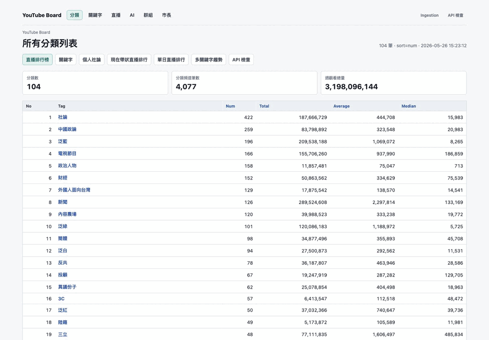

# 有影儀表板

有影儀表板 (YouTube Board) is the public YouTube data dashboard at [youtube.observe.tw](https://youtube.observe.tw), the successor of `youtube.board.tw`. It captures YouTube channel, video, live and comment data, rebuilds the dashboard caches, writes daily/hourly AI summaries and posts Telegram digests.

Everything runs on the TypeScript platform in [`platform/`](platform/README.md): the Next.js site, the Fastify API, and the BullMQ scheduler and workers that own every background workflow.

## History

The project was first rebuilt in Laravel. On 2026-10-12 the public frontend moved to TypeScript, and on 2026-10-18 every scheduled workflow was handed off to the TypeScript workers ([plan](platform/docs/laravel-scheduler-handoff-2026-10-18.md), [record](platform/docs/scheduler-handoff-record-2026-10-18.md)). The Laravel services were deleted from production and the Laravel code was removed from this repository on 2026-10-19; it remains in the git history before that commit. The documents under [`docs/`](docs/) describe the legacy site and the Laravel period and are kept as history.

## Development

See [`platform/README.md`](platform/README.md) for local development, tests and builds, and [`platform/docs/`](platform/docs/) for release, handoff and operations records.

Keep secrets out of the repository. Production runtime configuration lives in Dokploy and on the host, not in git.

## License and attribution

Licensed under the [MIT License](LICENSE), copyright (c) 2026 Sky Hong.

The TypeScript frontend adapts shared layout, navigation, theme, scrolling and table primitives from [新文易數 (tag.observe.tw)](https://github.com/skyhong2002/tag.observe.tw). Its original MIT copyright and permission notice are retained in [platform/web/upstream/tag-observe-LICENSE](platform/web/upstream/tag-observe-LICENSE); adaptation details are in [the upstream attribution](platform/web/upstream/README.md). Third-party dependencies retain their respective licenses.
